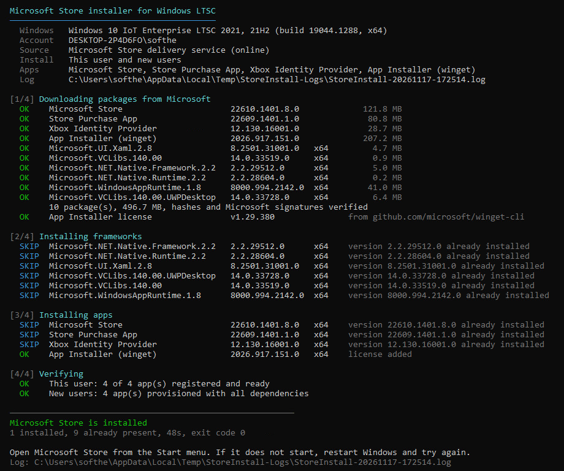

# Store-LTSC

[](https://github.com/Softhe/Store-LTSC/actions/workflows/tests.yml)

Store-LTSC installs Microsoft Store on Windows 10 and Windows 11 LTSC and IoT Enterprise editions, which ship without it.

## Install

Open PowerShell and run this command:

```powershell
irm https://raw.githubusercontent.com/Softhe/Store-LTSC/main/install.ps1 | iex
```

If PowerShell is not running as administrator, Windows shows a UAC prompt and the install continues in a new window. When the install finishes, open Microsoft Store from the Start menu. If the Store does not start, restart Windows and try again.

The command installs Microsoft Store, Store Purchase App, Xbox Identity Provider, App Installer with winget, and the frameworks they need. It downloads every package from Microsoft's Store delivery service and checks each file's hash and Microsoft signature before it installs anything.

To read the script before you run it, download [install.ps1](install.ps1) and [Install-Store.cmd](Install-Store.cmd) into the same folder. Read `install.ps1`, then double-click `Install-Store.cmd`.

### Running it again

You can run the command again at any time, for example to repair an installation. The script skips every package that is already installed at the same or a newer version, and it never replaces a newer Store or framework with an older one. When the installed App Installer is the same version as the downloaded one, the script provisions it again with its winget license, so winget works even if an earlier run could not get the license. A newer installed App Installer is left alone, and the script does not add the license to it. An online run downloads the packages again before it compares versions.

## Verified systems

| Edition | Version | Build | Verified |
| --- | --- | --- | --- |
| Windows 11 IoT Enterprise LTSC 2024 | 25H2 | 26200.9168 | 2026-10-17 |
| Windows 10 IoT Enterprise LTSC 2021 | 21H2 | 19044.1288 | 2026-11-17 |

| LTSC 2024 | LTSC 2021 |
| --- | --- |
| <a href="assets/microsoft-store-ltsc.png"></a> | <a href="assets/microsoft-store-ltsc2021.png"></a> |

Click a screenshot to see it at full size.

## Requirements

- Windows 10 or Windows 11, build 19041 or later. LTSC 2021 and LTSC 2024 qualify. LTSC 2019 and older releases are below the minimum build.
- An x64, ARM64 or x86 processor.
- Windows PowerShell 5.1 in FullLanguage mode. If you start the script in PowerShell 7, or in 32-bit PowerShell on 64-bit Windows, it restarts itself in 64-bit Windows PowerShell.
- Administrator rights to install packages. Download-only mode needs none.
- Network access to these hosts for online downloads:
  - `displaycatalog.mp.microsoft.com`, `fe3.delivery.mp.microsoft.com` and `*.dl.delivery.mp.microsoft.com` for the packages.
  - `raw.githubusercontent.com` for the install command.
  - `api.github.com` and `github.com` for the App Installer license.

Microsoft's service offers the same packages to every Windows build, so the script reads the minimum Windows version that each app declares. When the newest version of an app does not support the machine, the script tries the next version on offer. On 2026-11-17, the current versions of all four apps supported LTSC 2021, build 19044.

## Options

To pass options to the online command, use this form:

```powershell
& ([scriptblock]::Create((irm https://raw.githubusercontent.com/Softhe/Store-LTSC/main/install.ps1))) -SkipWinget
```

| Option | Effect |
| --- | --- |
| `-SkipWinget` | Leaves out App Installer and winget. |
| `-NoProvision` | Installs for the current user only and does not provision packages for new users. It still needs administrator rights. |
| `-DownloadOnly` | Downloads the packages without installing them. |
| `-DownloadDir D:\StorePkgs` | Saves downloads in this folder and keeps them after the install. |
| `-Source Online` | Downloads packages from Microsoft. The PowerShell script uses this by default. |
| `-Source Local -WorkDir D:\StorePkgs` | Installs the packages in this folder and downloads nothing. |
| `-Source Auto -WorkDir D:\StorePkgs` | Uses the local packages if the folder holds a Store package, and downloads them otherwise. |
| `-KeepDownloads` | Keeps the packages in the run's temporary download folder. The log shows its path. |
| `-DownloadTimeoutSeconds 1800` | Sets the time limit for each download attempt. The default is 1800 seconds. |
| `-LogDir D:\StoreLogs` | Writes logs to this folder. |
| `-Help` | Lists the options. |

When you run a saved copy, `-WorkDir` defaults to the script's folder. `Install-Store.cmd` adds `-Source Auto` unless you pass `-Source` yourself, and passes on every other option. If you start it without administrator rights, the installer shows a UAC prompt and continues in a new window. That window stays open until you press Enter.

## Offline installation

On a Windows machine with internet access, download the packages:

```powershell
& ([scriptblock]::Create((irm https://raw.githubusercontent.com/Softhe/Store-LTSC/main/install.ps1))) -DownloadOnly -DownloadDir D:\StorePkgs
```

The script picks packages for the architecture and Windows build of the machine that downloads them. Use a machine with the same architecture and Windows version as the offline target.

Put [install.ps1](install.ps1) and [Install-Store.cmd](Install-Store.cmd) in `D:\StorePkgs` next to the packages. Keep the `store-packages.json` manifest that the download creates. Copy the folder to the target machine and double-click `Install-Store.cmd`.

With the manifest present, the script checks the target architecture, the requested apps, and each file's size, SHA-256 hash and Microsoft signature before it installs anything. Folders without a manifest still work. The script then skips its own hash and signature checks, and Windows performs its usual package validation.

You can also run the saved script from an elevated Windows PowerShell window:

```powershell
powershell.exe -NoProfile -ExecutionPolicy Bypass -File D:\StorePkgs\install.ps1 -Source Local -WorkDir D:\StorePkgs
```

### License files

If you have license XML files, put them next to the packages and name each one `<PackageFamilyName>.xml`, for example `Microsoft.WindowsStore_8wekyb3d8bbwe.xml`. The script also recognises a license by its content, such as the `*_License1.xml` file from a winget release. The script provisions packages that have no matching license file with `-SkipLicense`.

winget needs its license. Without it, winget fails with `No applicable app licenses found`. Microsoft's Store delivery service does not provide that license, so online runs download it from the latest [winget-cli release](https://github.com/microsoft/winget-cli/releases/latest). Download-only runs save it in the download folder as `Microsoft.DesktopAppInstaller_8wekyb3d8bbwe.xml`. Windows checks the license signature when it provisions App Installer.

If the script cannot get the license, it still installs App Installer and reports a partial failure, and winget does not run. Run the script again once the license is available. It adds the license to an installed App Installer of the same version.

## How it works

The script picks the newest app versions that support your Windows build, downloads only the frameworks those apps declare, and verifies every file before it installs it. It never replaces a newer package with an older one, and after installing it asks Windows to confirm each app is registered and provisioned. When it runs as SYSTEM, for example through Intune, SCCM or MDT, it only provisions packages, and Windows registers them for each user at sign-in.

[How it works](docs/how-it-works.md) describes package selection, download checks, the install order and verification in full.

## Logs and troubleshooting

<a href="assets/installer-console-ltsc2021.png"></a>

*The install command run again on LTSC 2021. It downloads the packages, skips those already installed, adds the winget license and verifies the result.*

In a console window, the current step is one line that updates in place. A download shows a progress bar, the amount transferred, the speed and the time left. An install step shows its elapsed time. Each finished package gets a line with its status, which is `OK`, `SKIP`, `WARN` or `FAIL`. The run ends with the number of packages installed, already present and failed, the elapsed time and the exit code, and lists any problems again.

When output is redirected, for example in CI, in MDT or with `*> run.log` in PowerShell, the script writes only the finished lines, each as one plain line.

The log file records every step with timestamps, including package file names and full error messages. The script prints the log path at the start and at the end. A saved copy writes logs to the `Logs` folder inside its working folder. The online command writes logs to `%TEMP%\StoreInstall-Logs`, and so does a saved copy whose folder is not writable.

If Microsoft Store does not open, restart Windows and check the log. Event Viewer also records deployment errors under `Applications and Services Logs > Microsoft > Windows > AppXDeployment-Server`.

If downloads fail, check that the machine can reach the hosts listed under Requirements, and check any proxy or firewall rules.

<details>
<summary>Exit codes</summary>

| Code | Meaning |
| --- | --- |
| 0 | The run succeeded. |
| 1 | The script lacks administrator rights. You declined the UAC prompt, or Windows could not show one. |
| 2 | The Windows build is below 19041. |
| 3 | PowerShell is not in FullLanguage mode. |
| 4 | A required package or dependency is missing, incompatible or invalid. |
| 5 | Microsoft Store installed, but another step failed. A requested app was unavailable, an install or provisioning step failed, or verification could not confirm a companion app or a dependency for new users. In download-only mode, the download set is incomplete. |
| 6 | Microsoft Store failed to install or provision, or Windows did not register it for the current user. |
| 7 | A fatal error, an unknown option or an invalid setting stopped the run. |
| 8 | A package lookup, download or verification failed. |

When you run the script through `irm | iex`, it puts the exit code in `$LASTEXITCODE` and leaves the PowerShell window open. Early checks, such as the language mode or the Windows build, can stop the script before it creates a log.

</details>

[Installer reliability and validation](docs/installer-reliability.md) covers the offline manifest, the regression tests and the tests still needed before a release.
