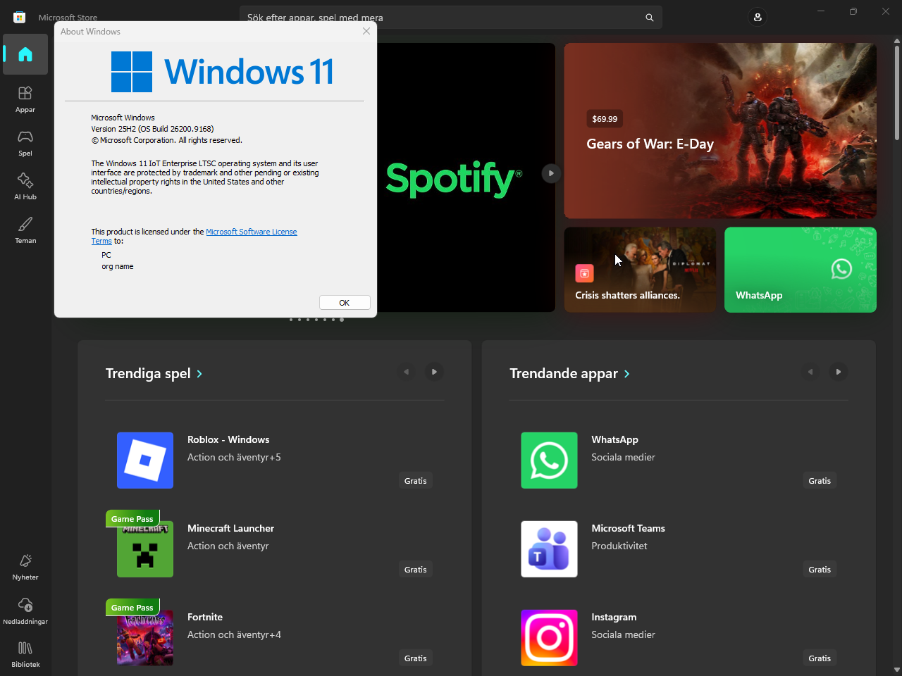

# Store-LTSC

Install Microsoft Store on Windows 10 and Windows 11 LTSC or IoT Enterprise systems that do not include it.

The PowerShell script downloads packages directly from Microsoft's Store delivery service. It installs Microsoft Store, Store Purchase App, Xbox Identity Provider, App Installer with winget, and their framework dependencies. You can also download packages for an offline installation.



*Microsoft Store running on Windows 11 IoT Enterprise LTSC.*

## Install

Open PowerShell and run:

```powershell
irm https://raw.githubusercontent.com/Softhe/Store-LTSC/main/install.ps1 | iex
```

Accept the UAC prompt if PowerShell is not already running as administrator. After installation, open Microsoft Store from the Start menu. Reboot first if this is a fresh LTSC or IoT Enterprise installation.

To read the script before running it, download [install.ps1](install.ps1) and [Install-Store.cmd](Install-Store.cmd) into the same folder. Review the PowerShell script, then double-click `Install-Store.cmd`.

## Requirements

- Windows 10 or Windows 11, build 19041 or later. This includes LTSC 2021 and LTSC 2024. Older LTSC releases are below the script's minimum build.
- An x64, ARM64, or x86 system.
- Windows PowerShell 5.1 with FullLanguage mode. The script relaunches in Windows PowerShell if you start it in PowerShell 7, or in a 32-bit process on 64-bit Windows.
- Administrator rights to install packages. Download-only mode does not require elevation.
- For online downloads, access to `displaycatalog.mp.microsoft.com`, `fe3.delivery.mp.microsoft.com`, and `*.dl.delivery.mp.microsoft.com`. The command above also needs access to `raw.githubusercontent.com`.

The minimum build check does not guarantee that every current Store package or app supports every Windows version.

## Options

To pass options when running the script from GitHub, use this form:

```powershell
& ([scriptblock]::Create((irm https://raw.githubusercontent.com/Softhe/Store-LTSC/main/install.ps1))) -SkipWinget
```

| Option | Effect |
| --- | --- |
| `-SkipWinget` | Skip App Installer and winget. |
| `-NoProvision` | Install for the current user without provisioning packages for other users. Administrator rights are still required. |
| `-DownloadOnly` | Download packages without installing them. |
| `-DownloadDir D:\StorePkgs` | Save downloads in this folder and keep them after installation. |
| `-Source Online` | Download packages from Microsoft. This is the PowerShell script's default. |
| `-Source Local -WorkDir D:\StorePkgs` | Install packages from this folder without downloading. |
| `-Source Auto -WorkDir D:\StorePkgs` | Use local packages if the folder contains a Store package. Otherwise, download them. |
| `-KeepDownloads` | Keep packages in the run's temporary download folder. The log shows its path. |
| `-DownloadTimeoutSeconds 1800` | Set the time limit for each package download attempt. The default is 1800 seconds. |
| `-LogDir D:\StoreLogs` | Write logs to this folder. |

`-WorkDir` defaults to the script's folder when running a saved copy. The command launcher uses `-Source Auto` by default and passes through any options you supply.

## Offline installation

On a Windows machine with internet access, download the packages:

```powershell
& ([scriptblock]::Create((irm https://raw.githubusercontent.com/Softhe/Store-LTSC/main/install.ps1))) -DownloadOnly -DownloadDir D:\StorePkgs
```

Download-only mode selects packages for the downloading machine's architecture and Windows build. Prepare the folder on a machine with the same architecture and Windows version as the offline target.

Save [install.ps1](install.ps1) and [Install-Store.cmd](Install-Store.cmd) in `D:\StorePkgs`, alongside the downloaded packages. Keep the generated `store-packages.json` manifest in the folder. Copy the folder to the target machine, then double-click `Install-Store.cmd`.

When a manifest is present, the script checks the target architecture, requested apps, file sizes, SHA-256 hashes, and Microsoft signatures before installation. Legacy folders without a manifest still work, but do not receive those independent hash and Microsoft-signer checks.

You can also run the saved script from an elevated Windows PowerShell window:

```powershell
powershell.exe -NoProfile -ExecutionPolicy Bypass -File D:\StorePkgs\install.ps1 -Source Local -WorkDir D:\StorePkgs
```

If you have license XML files, put them beside the packages and name them `<PackageFamilyName>.xml`. For example, use `Microsoft.WindowsStore_8wekyb3d8bbwe.xml` for the Store. Without a matching license file, the script provisions packages with `-SkipLicense`.

## What the script does

In online mode, the script looks up the apps in Microsoft's Store catalog and requests package metadata from the Store delivery service. It selects app packages by the service's package rank, then version and architecture. It selects the newest offered framework version for each usable architecture, including x86 frameworks on x64 and ARM64 systems.

For each download, the script checks the file size and the hash supplied by Microsoft over HTTPS. It uses SHA-256 when available and falls back to SHA-1. It also requires a valid Microsoft Corporation code signature before replacing the destination file. Failed attempts remove their temporary files, and the script retries before reporting a failure.

For local packages, the script reads identities and dependencies from package manifests. It filters unsupported architectures and Windows versions before selecting apps. Missing dependencies and framework dependency cycles stop the run before installation.

The script installs frameworks in dependency order, followed by Microsoft Store and the companion apps. By default, it provisions packages in the Windows image and registers them for the current user. `-NoProvision` skips provisioning. Missing requested companion apps produce a partial-failure result, including in download-only mode.

When run as SYSTEM, such as through Intune, SCCM, or MDT, the script only provisions packages. Windows registers them for users at sign-in. Do not combine SYSTEM execution with `-NoProvision`.

Each run uses a separate temporary download folder. The script verifies ownership before deleting that folder when installation finishes. `-KeepDownloads`, download-only mode, and a custom `-DownloadDir` keep the packages.

If the script needs to relaunch, it runs a snapshot of the same executing revision and preserves the supplied options.

The online downloader relies on an undocumented Microsoft service. Changes to that service can break downloads. Local mode uses the packages you have already saved.

## Logs and troubleshooting

The script prints its log path when installation starts. Saved copies normally write logs to `Logs` inside the working folder. When run through the online command, or if that folder is not writable, logs go to `%TEMP%\StoreInstall-Logs`.

If Microsoft Store does not open, reboot after a fresh Windows installation, then check the installation log. You can also check Event Viewer under `Applications and Services Logs > Microsoft > Windows > AppXDeployment-Server`.

For download failures, check access to the Microsoft domains listed in the requirements and review any proxy or firewall restrictions.

### Exit codes

| Code | Meaning |
| --- | --- |
| 0 | Completed successfully. |
| 1 | Administrator rights are missing, or elevation was declined or unavailable. |
| 2 | Windows build is below 19041. |
| 3 | PowerShell is not in FullLanguage mode. |
| 4 | A required package or dependency is missing, incompatible, or invalid. |
| 5 | A requested app is unavailable, or an installation or provisioning step failed after the Store step succeeded. Download-only sets can also be incomplete. |
| 6 | The Store installation or provisioning step failed. |
| 7 | A fatal error or invalid configuration stopped the run. |
| 8 | Package lookup, download, or verification failed. |

When run through `irm | iex`, the script returns the result in `$LASTEXITCODE` and leaves the PowerShell window open. Early checks, such as a rejected language mode or Windows build, can stop the script before it creates a log.

See [installer reliability and validation](docs/installer-reliability.md) for offline manifest details, regression test commands, and the remaining LTSC installation qualification steps.
