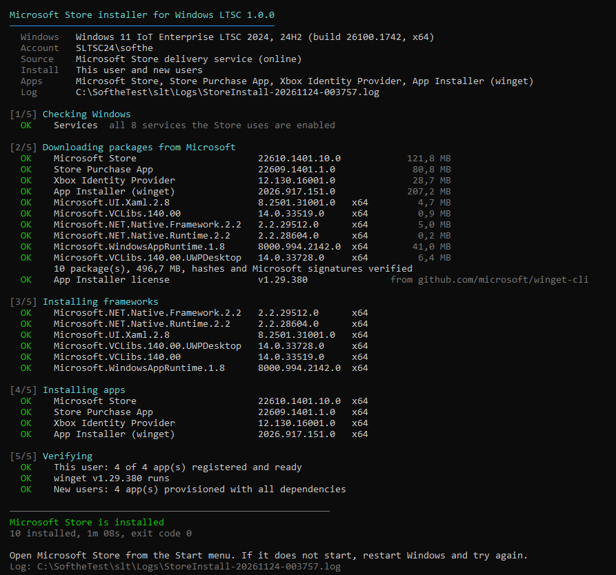
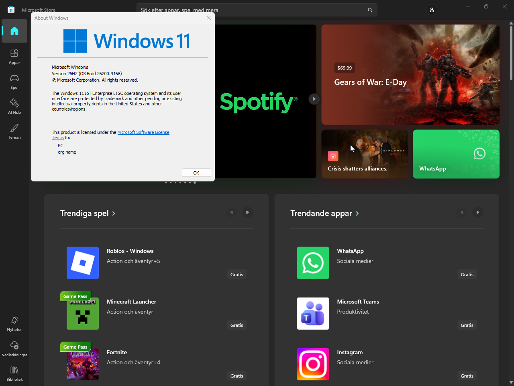
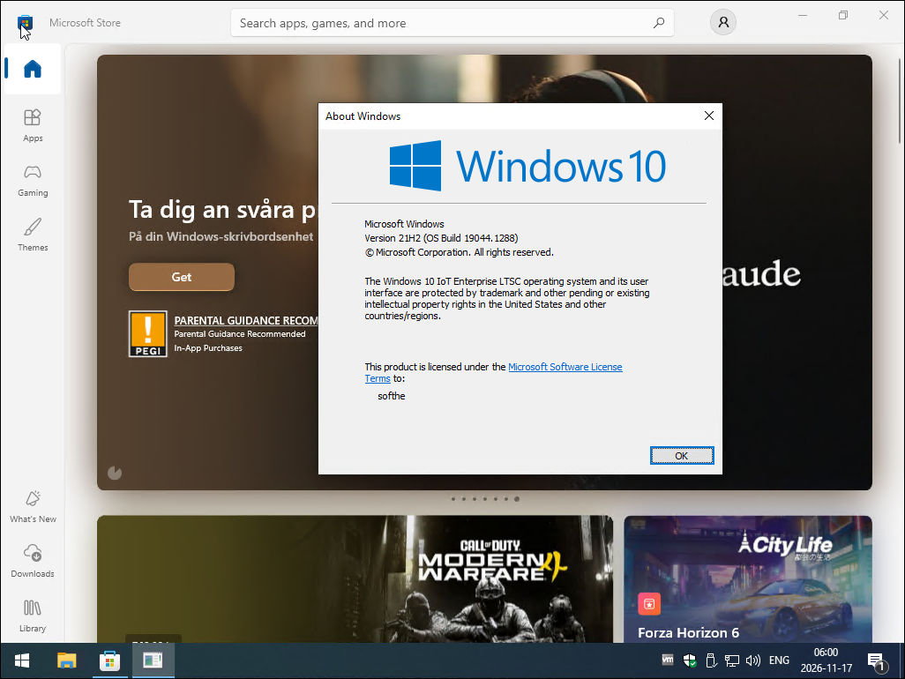
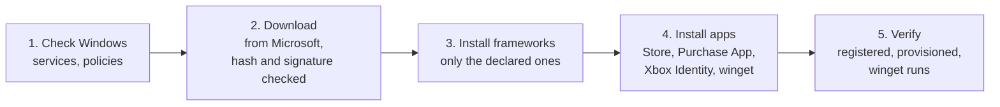

<div align="center">

# Store-LTSC

**Microsoft Store and winget for Windows 10 and 11 LTSC and IoT Enterprise, with one command.**

[](https://github.com/Softhe/Store-LTSC/actions/workflows/tests.yml)
[](https://github.com/Softhe/Store-LTSC/actions/workflows/live-catalog.yml)


[Install](#install) · [Verified systems](#verified-systems) · [Options](#options) · [Offline installation](#offline-installation) · [Troubleshooting](#logs-and-troubleshooting) · [Changelog](CHANGELOG.md)

</div>

LTSC and IoT Enterprise editions of Windows ship without Microsoft Store. Store-LTSC downloads the Store, its companion apps and winget straight from Microsoft, checks every file, and installs them for you and for every new user on the PC.

<p align="center">
  <a href="assets/installer-console-ltsc2024.png"></a>
  <br>
  <sub>A fresh install on Windows 11 IoT Enterprise LTSC 2024: 10 packages in about a minute.</sub>
</p>

## Install

Open PowerShell and run:

```powershell
irm https://raw.githubusercontent.com/Softhe/Store-LTSC/main/install.ps1 | iex
```

When it finishes, open **Microsoft Store** from the Start menu. If the Store doesn't start, restart Windows and try again.

> [!NOTE]
> If PowerShell isn't running as administrator, Windows shows a UAC prompt and the install continues in a new window.

> [!TIP]
> Did a debloat tool turn off Windows Update or the Store services? The installer checks for that first and tells you. Add `-FixServices` to turn them back on:
>
> ```powershell
> & ([scriptblock]::Create((irm https://raw.githubusercontent.com/Softhe/Store-LTSC/main/install.ps1))) -FixServices
> ```

To read the script before you run it, download [install.ps1](install.ps1) and [Install-Store.cmd](Install-Store.cmd) into the same folder. Read `install.ps1`, then double-click `Install-Store.cmd`.

### What you get

| App | What it's for |
| --- | --- |
| **Microsoft Store** | Browse, install and update Store apps. |
| **Store Purchase App** | Buying apps and in-app purchases. |
| **Xbox Identity Provider** | Signing in to games and Xbox services. |
| **App Installer (winget)** | The `winget` command, licensed so that it runs. |
| Frameworks | Only the ones these apps declare, such as VCLibs, UI.Xaml and the Windows App Runtime. |

### Why it's safe to run

|  |  |
| --- | --- |
| 🔒 **Straight from Microsoft** | Packages come from Microsoft's Store delivery service, the same one the Store app uses. Each file's hash and Microsoft signature are checked before anything is installed. |
| 🩺 **Checks Windows first** | Disabled services, Group Policies that turn the Store off, and a wrong clock are reported before they can leave you with a Store that doesn't work. |
| ↩️ **Never downgrades** | Packages already installed at the same or a newer version are skipped, so a Store that updated itself is left alone. |
| ✅ **Verifies the result** | Windows is asked to confirm each app is registered and provisioned, and winget is run once to prove it starts. |
| 🔁 **Safe to run again** | Run it again at any time to repair an installation. |

### Running it again

You can run the command again at any time, for example to repair an installation. The script skips every package that is already installed at the same or a newer version, and it never replaces a newer Store or framework with an older one. When the installed App Installer is the same version as the downloaded one, the script provisions it again with its winget license, so winget works even if an earlier run could not get the license. The script leaves a newer installed App Installer alone and does not add the license to it. An online run downloads the packages again before it compares versions.

### Running a specific version

The command above always runs the newest script on `main`. To run a fixed [release](https://github.com/Softhe/Store-LTSC/releases), put its tag in the address:

```powershell
irm https://raw.githubusercontent.com/Softhe/Store-LTSC/v1.0.0/install.ps1 | iex
```

Each release lists the SHA-256 of `install.ps1` and `Install-Store.cmd`, and [CHANGELOG.md](CHANGELOG.md) lists what changed. The script prints its version at the start of each run and in the log.

## Verified systems

| Edition | Version | Build | Verified |
| --- | --- | --- | --- |
| Windows 11 IoT Enterprise LTSC 2024 | 24H2 | 26100.1742 | 2026-11-24, fresh install in a VM |
| Windows 11 IoT Enterprise LTSC 2024 | 25H2 | 26200.9168 | 2026-10-17 |
| Windows 10 IoT Enterprise LTSC 2021 | 21H2 | 19044.1288 | 2026-11-17 |

| LTSC 2024 | LTSC 2021 |
| --- | --- |
| <a href="assets/microsoft-store-ltsc.png"></a> | <a href="assets/microsoft-store-ltsc2021.png"></a> |

Click a screenshot to see it at full size.

### LTSC 2019

> [!WARNING]
> Windows 10 Enterprise LTSC 2019 (build 17763) is not supported. The script stops with exit code 2.

A test on 2026-11-23 showed why. With the build check lowered, the script installed Store 12107, the newest version that supports build 17763. The Store opened with a Microsoft message asking to upgrade to a supported Windows version. Its app pages did not load, so it could not install any app.

## Requirements

- Windows 10 or Windows 11, build 19041 or later. LTSC 2021 and LTSC 2024 qualify. LTSC 2019 and older releases are below the minimum build. [LTSC 2019](#ltsc-2019) explains why.
- An x64, ARM64 or x86 processor.
- Windows PowerShell 5.1 in FullLanguage mode. If you start the script in PowerShell 7, or in 32-bit PowerShell on 64-bit Windows, it restarts itself in 64-bit Windows PowerShell.
- Administrator rights to install packages. Download-only mode needs none.
- Network access to these hosts for online downloads:
  - `displaycatalog.mp.microsoft.com`, `fe3.delivery.mp.microsoft.com` and `*.dl.delivery.mp.microsoft.com` for the packages.
  - `raw.githubusercontent.com` for the install command.
  - `api.github.com` and `github.com` for the App Installer license.

Microsoft's service offers the same packages to every Windows build, so the script reads the minimum Windows version that each app declares. When the newest version of an app does not support the machine, the script tries the next version on offer. On 2026-11-17, the current versions of all four apps supported LTSC 2021, build 19044.

## How it works



The script picks the newest app versions that support your Windows build, downloads only the frameworks those apps declare, and verifies every file before it installs it. It never replaces a newer package with an older one, and after installing it asks Windows to confirm each app is registered and provisioned. When it runs as SYSTEM, for example through Intune, SCCM or MDT, it only provisions packages, and Windows registers them for each user at sign-in.

[How it works](docs/how-it-works.md) describes package selection, download checks, the install order and verification in full.

## Options

To pass options to the online command, use this form:

```powershell
& ([scriptblock]::Create((irm https://raw.githubusercontent.com/Softhe/Store-LTSC/main/install.ps1))) -SkipWinget
```

| Option | Effect |
| --- | --- |
| `-SkipWinget` | Leaves out App Installer and winget. |
| `-NoProvision` | Installs for the current user only and does not provision packages for new users. It still needs administrator rights. |
| `-FixServices` | Sets disabled services the Store needs back to Manual before installing. Windows then starts them when they are needed. |
| `-CollectLogs` | Installs nothing and saves a diagnostics zip for a bug report. See [Reporting a problem](#reporting-a-problem). |
| `-DownloadOnly` | Downloads the packages without installing them. |
| `-TargetBuild 19044` | With `-DownloadOnly`, picks packages for this Windows build instead of this PC's. |
| `-TargetArch arm64` | With `-DownloadOnly`, picks packages for `x64`, `arm64` or `x86` instead of this PC's architecture. |
| `-DownloadDir D:\StorePkgs` | Saves downloads in this folder and keeps them after the install. |
| `-Source Online` | Downloads packages from Microsoft. The PowerShell script uses this by default. |
| `-Source Local -WorkDir D:\StorePkgs` | Installs the packages in this folder and downloads nothing. |
| `-Source Auto -WorkDir D:\StorePkgs` | Uses the local packages if the folder holds a Store package, and downloads them otherwise. |
| `-KeepDownloads` | Keeps the packages in the run's temporary download folder. The log shows its path. |
| `-DownloadTimeoutSeconds 1800` | Sets the time limit for each download attempt. The default is 1800 seconds. |
| `-LogDir D:\StoreLogs` | Writes logs to this folder. |
| `-Help` | Lists the options. |

When you run a saved copy, `-WorkDir` defaults to the script's folder. `Install-Store.cmd` adds `-Source Auto` unless you pass `-Source` yourself, and passes on every other option. If you start it without administrator rights, the installer shows a UAC prompt and continues in a new window. That window stays open until you press Enter.

## Offline installation

On a Windows machine with internet access, download the packages:

```powershell
& ([scriptblock]::Create((irm https://raw.githubusercontent.com/Softhe/Store-LTSC/main/install.ps1))) -DownloadOnly -DownloadDir D:\StorePkgs
```

The script picks packages for the architecture and Windows build of the machine that downloads them. To prepare a folder for a different target, name its build and architecture. For example, for an ARM64 PC running LTSC 2021:

```powershell
& ([scriptblock]::Create((irm https://raw.githubusercontent.com/Softhe/Store-LTSC/main/install.ps1))) -DownloadOnly -TargetBuild 19044 -TargetArch arm64 -DownloadDir D:\StorePkgs
```

Put [install.ps1](install.ps1) and [Install-Store.cmd](Install-Store.cmd) in `D:\StorePkgs` next to the packages. Keep the `store-packages.json` manifest that the download creates. Copy the folder to the target machine and double-click `Install-Store.cmd`.

With the manifest present, the script checks the target architecture, the requested apps, and each file's size, SHA-256 hash and Microsoft signature before it installs anything. Folders without a manifest still work. The script then skips its own hash and signature checks, and Windows performs its usual package validation.

You can also run the saved script from an elevated Windows PowerShell window:

```powershell
powershell.exe -NoProfile -ExecutionPolicy Bypass -File D:\StorePkgs\install.ps1 -Source Local -WorkDir D:\StorePkgs
```

<details>
<summary><b>License files</b></summary>

If you have license XML files, put them next to the packages and name each one `<PackageFamilyName>.xml`, for example `Microsoft.WindowsStore_8wekyb3d8bbwe.xml`. The script also recognises a license by its content, such as the `*_License1.xml` file from a winget release. The script provisions packages that have no matching license file with `-SkipLicense`.

winget needs its license. Without it, winget fails with `No applicable app licenses found`. Microsoft's Store delivery service does not provide that license, so online runs download it from the latest [winget-cli release](https://github.com/microsoft/winget-cli/releases/latest). Download-only runs save it in the download folder as `Microsoft.DesktopAppInstaller_8wekyb3d8bbwe.xml`. Windows checks the license signature when it provisions App Installer.

If the script cannot get the license, it still installs App Installer and reports a partial failure, and winget does not run. Run the script again once the license is available. It adds the license to an installed App Installer of the same version.

</details>

## Logs and troubleshooting

In a console window, the current step is one line that updates in place. A download shows a progress bar, the amount transferred, the speed and the time left. An install step shows its elapsed time. Each finished package gets a line with its status:

| Status | Meaning |
| --- | --- |
| `OK` | Installed, downloaded or confirmed. |
| `SKIP` | Already installed at the same or a newer version. |
| `WARN` | Done, but something needs your attention. The summary repeats it. |
| `FAIL` | This step failed. The summary repeats it and the log has the full error. |

The run ends with the number of packages installed, already present and failed, the elapsed time and the exit code, and lists any problems again. When output is redirected, for example in CI, in MDT or with `*> run.log` in PowerShell, the script writes only the finished lines, each as one plain line.

The log file records every step with timestamps, including package file names and full error messages. The script prints the log path at the start and at the end. A saved copy writes logs to the `Logs` folder inside its working folder. The online command writes logs to `%TEMP%\StoreInstall-Logs`, and so does a saved copy whose folder is not writable.

If Microsoft Store does not open, restart Windows and check the log. Event Viewer also records deployment errors under `Applications and Services Logs > Microsoft > Windows > AppXDeployment-Server`. If downloads fail, check that the machine can reach the hosts listed under [Requirements](#requirements), and check any proxy or firewall rules.

### Windows settings that stop the Store

The first step of each install checks these settings. Problems that do not stop the install are listed again under the summary.

- **Disabled services.** The Store needs Windows Update, Microsoft Store Install Service, Client License Service, Windows License Manager, Delivery Optimization and Web Account Manager to download, license and sign in. Without them the install succeeds, but the Store cannot download apps and often shows error `0x80070422`. App installation itself needs AppX Deployment Service and State Repository Service. If either is disabled, the script stops with exit code 9 before it changes anything. Run the installer again with `-FixServices` to set the disabled services to Manual.
- **Group Policies.** `RemoveWindowsStore` and `DisableStoreApps` under `SOFTWARE\Policies\Microsoft\WindowsStore` turn the Store off, and `DoNotConnectToWindowsUpdateInternetLocations` blocks its downloads. With `RemoveWindowsStore` set, the installed Store opens to "Microsoft Store is blocked". The script shows the registry path of each policy it finds but does not change policies.
- **The clock.** If the Windows clock is 5 or more minutes off, the summary says so. The download works anyway, but a wrong clock can break Store sign-in and app licenses. Turn on *Set time automatically*, or run `w32tm /resync` as administrator.

> [!IMPORTANT]
> **`-FixServices` may need a restart.** Windows doesn't let administrators change AppX Deployment Service, Client License Service or Delivery Optimization while it runs. The script changes their setting in the registry instead, and Windows applies it at the next restart. If AppX Deployment Service was disabled, the run stops with exit code 9 and asks you to restart Windows, then run the installer again. Each line in the output says whether a change applies now or after a restart.

After installing, the script runs `winget --version` once to confirm that winget starts.

### Reporting a problem

Run the installer with `-CollectLogs` on the affected PC:

```powershell
& ([scriptblock]::Create((irm https://raw.githubusercontent.com/Softhe/Store-LTSC/main/install.ps1))) -CollectLogs
```

It installs nothing. It saves `Store-LTSC-diagnostics-<date>.zip` on the desktop with the Windows version, service states, Store policies, the installed and provisioned Store packages, winget's state, AppX deployment errors from the last 7 days, network checks and the last five installer logs. User, computer and domain names and account SIDs are replaced with placeholders. Look through the files, then attach the zip to a [bug report](https://github.com/Softhe/Store-LTSC/issues/new/choose).

<details>
<summary><b>Exit codes</b></summary>

| Code | Meaning |
| --- | --- |
| 0 | The run succeeded. |
| 1 | The script lacks administrator rights. You declined the UAC prompt, or Windows could not show one. |
| 2 | The Windows build is below 19041. |
| 3 | PowerShell is not in FullLanguage mode. |
| 4 | A required package or dependency is missing, incompatible or invalid. |
| 5 | Microsoft Store installed, but another step failed. A requested app was unavailable, an install or provisioning step failed, verification could not confirm a companion app or a dependency for new users, or winget did not start. In download-only mode, the download set is incomplete. |
| 6 | Microsoft Store failed to install or provision, or Windows did not register it for the current user. |
| 7 | A fatal error, an unknown option or an invalid setting stopped the run. |
| 8 | A package lookup, download or verification failed. |
| 9 | AppX Deployment Service or State Repository Service is disabled or missing, so Windows cannot install apps. `-FixServices` sets a disabled service to Manual. If the output asks you to restart Windows, restart, then run the installer again. |

When you run the script through `irm | iex`, it puts the exit code in `$LASTEXITCODE` and leaves the PowerShell window open. Early checks, such as the language mode or the Windows build, can stop the script before it creates a log.

</details>

---

[Installer reliability and validation](docs/installer-reliability.md) covers the offline manifest, the regression tests, the daily live check, the release process and the tests still needed before a release.
